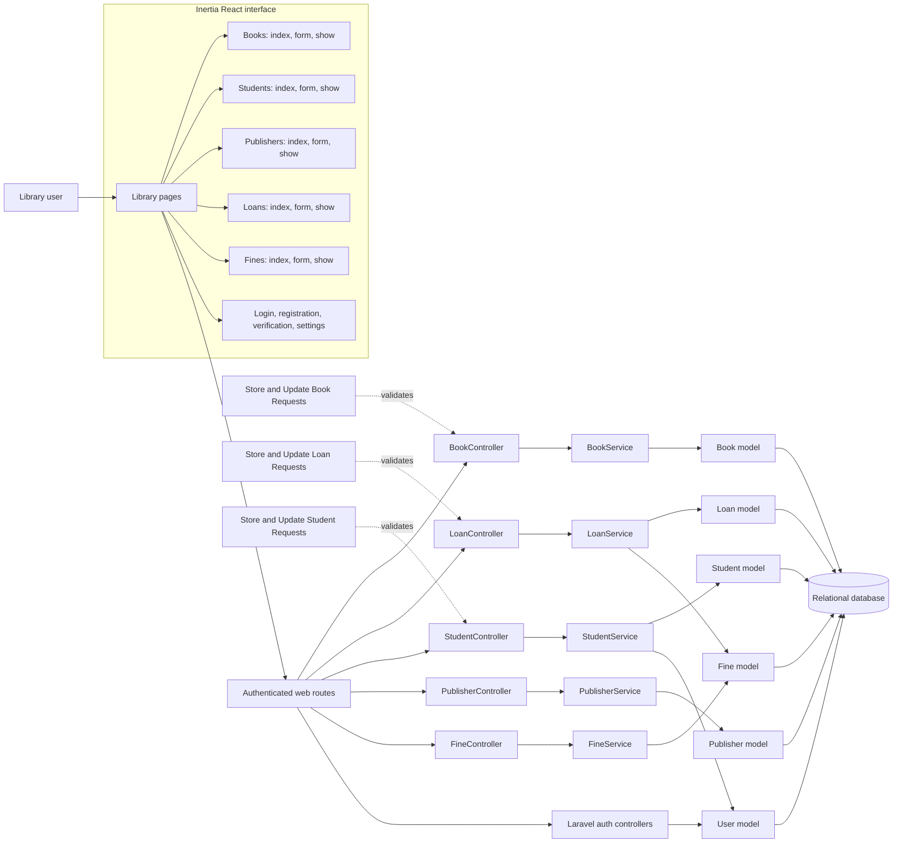
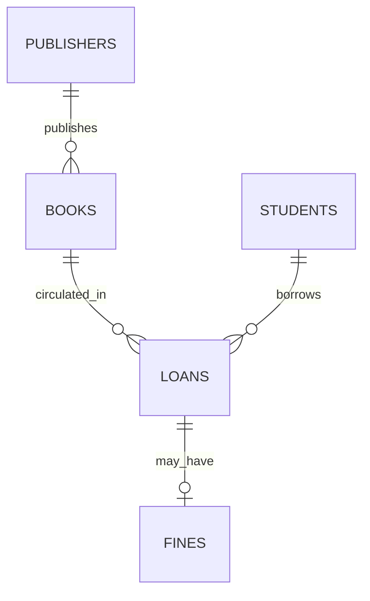

## INITIAL SCORE - 60/100

# University Library Book Circulation System

**Student:** Raijen C. Astodillo | **Section:** BSIS 3B

A Laravel 12 and Inertia React application for managing a university library catalogue and book circulation.

## Architecture



- **Controllers** handle web requests and render pages.
- **Form Requests** check authorization and validate submitted data.
- **Services** contain circulation rules and coordinate database changes.
- **Eloquent models** represent the library records and their relationships.
- **Inertia React pages** under `resources/js/pages` provide index, form, and show interfaces for each resource, plus authentication and settings pages.

## Library modules

| Course reference concept | Library system equivalent |
| --- | --- |
| Warehouse operations and shipments | Loans, returns, and `LoanService` |
| Billing records | Fines |
| Cargo categories and companies | Publishers and students |
| User access and account records | Laravel authentication and user accounts |
| Interface pages | Inertia pages for books, students, publishers, loans, fines, and authentication |

Each publisher can have many books. Each book and student can have many loans. Each loan can have one fine.

## 3NF normalization

Assume `loan_id` identifies one loan. In `library_raw_loans`, each row combines one loan with student, book, publisher, and optional fine details. Student, book, and publisher facts repeat across loan rows, while fine fields are empty for loans without a fine. The main functional dependencies are:

- `loan_id -> student_number, book_isbn, issue_date, due_date, return_date, fine_per_day`
- `student_number -> student_name, student_email`
- `book_isbn -> book_title, author_name, publisher_name`
- `publisher_name -> publisher identity`
- For a loan with a fine, `loan_id -> calculated_fine, payment_status`

The raw row has atomic values and one loan identifier, so there are no partial dependencies on part of a composite key. It is still redundant: student and book details repeat each time the same student or book appears in another loan. There are also transitive dependencies through `student_number` and `book_isbn`. Moving those facts into their own tables removes the transitive dependencies and produces the 3NF schema below.

The decomposition keeps those facts with their own key and links them with foreign keys:

| Table | Key data | Relationship |
| --- | --- | --- |
| `students` | `student_number`, name, email | Has many loans |
| `publishers` | Publisher name | Has many books |
| `books` | ISBN, title, author, publisher ID | Belongs to a publisher; has many loans |
| `loans` | Student ID, book ID, issue/due/return dates, daily fine rate | Belongs to a student and a book; has one fine |
| `fines` | Loan ID, calculated fine, payment status | Belongs to one loan; loan ID is unique |

This removes student, book, and publisher descriptions from repeated loan rows and stores fine details separately. The five domain tables are the normalized schema; Laravel's user, cache, and queue tables support the application framework.



## Required focus models

`BookController` and `LoanController` provide paginated indexes, creation pages, and store/update actions. Their dedicated Form Requests validate inputs; `BookService` handles book sanitization and title-casing, while `LoanService` handles circulation transactions, fines, and the unpaid-fine borrowing limit. Student email addresses are trimmed and stored in lowercase by `StudentService`.


## Main application flow

1. A user visits an Inertia React page. Authenticated resource routes send the request to the matching controller.
2. Store and update actions use their Form Requests for authorization and validation, then pass validated data to the matching service.
3. The service sanitizes data and applies the business rules before saving through Eloquent models.
4. Loan creation checks the student's unpaid fine total. Returning or updating a loan recalculates its fine from overdue days and the daily rate in the same transaction.
5. The controller renders the resulting page or redirects back to the resource list.

Registration validates and creates a user account, then `StudentService` creates or synchronizes its student record before the user is signed in.

## Run locally

```sh
composer install
cp .env.example .env
php artisan key:generate
php artisan migrate --seed
npm install
npm run build
```

For local development, start the Laravel and Vite servers with `composer run dev`.
